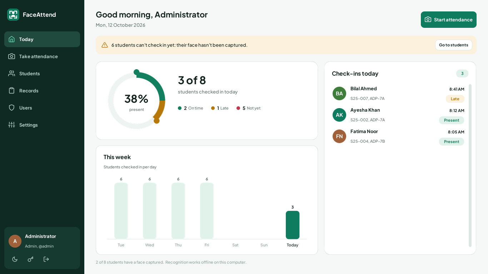

# FaceAttend: Desktop-Based Attendance System using Face Recognition

Final Year Project, Islamia University of Bahawalpur
Submitted by: **Nida** (S25BINFT7M04037)  Supervisor: **Dr. Rana Nazeer Ahmed**

A Windows desktop app that takes student attendance automatically from a webcam. It runs fully **offline**. Data is stored in a local **SQLite** database. Faces are found with the **YuNet** deep-learning detector and recognised with an **ArcFace** face-embedding model, both run on the CPU through **OpenCV**.

> Version 1.1 replaced the original Haar + LBPH recogniser after an audit showed LBPH accepted strangers as enrolled students. See [AUDIT_REPORT.md](AUDIT_REPORT.md).
> Version 1.2 is a full redesign of the interface: a modern app look with light and dark mode.



---

## 1. Quick start (Windows)

1. Install **Python 3.10 – 3.13** from <https://www.python.org/downloads/>. During setup, tick **“Add python.exe to PATH”**.
2. Unzip this folder and double-click **`run.bat`**.
   - The first run creates a virtual environment and installs the libraries. This needs internet once and takes about 2 minutes.
   - After that, the app starts instantly and works without internet.
3. Sign in with the default admin account: **`admin` / `admin123`**. Change this password straight away (sidebar → *Change password*).

Manual alternative:
```bash
pip install -r requirements.txt
python main.py
```

**Upgrading from an earlier version?** Delete the old `.venv` folder so `run.bat` installs the new libraries. Then recapture every student's face, because v1.0 samples can't be used by the new model.

### Build a standalone .exe (optional)
Run `run.bat` once, then run **`build_exe.bat`**. Copy `dist\FaceAttend\` to any Windows PC and run `FaceAttend.exe`. No Python is needed on that PC.

---

## 2. The interface

The interface is built with **CustomTkinter**, a modern rounded-widget toolkit on top of Tkinter. Its identity comes from the university's green.

| | |
|---|---|
| **Colour** | Emerald `#0F7B5F` primary, deep pine sidebar, green-tinted paper background. Present, late and absent always use the same green, marigold and rose. |
| **Type** | Plus Jakarta Sans (bundled, OFL licence), loaded privately at start-up, so nothing is installed on the PC. |
| **Icons** | Feather line icons (MIT licence), tinted to the theme. |
| **Light / dark** | Switch with the moon/sun button in the sidebar or in Settings → Appearance. The choice is remembered. |
| **Faces** | Each student's enrolled face photo is their avatar everywhere; students without one get coloured initials. |
| **Feedback** | Slide-in toasts confirm actions; destructive actions ask first in a clear dialog with a red button; forms show problems inline. |

**Screens**
- **Today** shows the attendance ring (*3 of 8 present*), this week's chart and live check-ins.
- **Take attendance** shows the camera with scan-corner face boxes and a check-in card that slides in with the student's photo.
- **Students** is a list with a detail panel: photo, attendance this month and that student's actions. *Delete* sits apart at the bottom.
- **Records** has a *Daily sheet* with a calendar date picker and status counts, and a *Student report* for any date range. Both export to CSV.
- **Users** and **Settings** are for admins only.

**Button layout rules:** one primary (green) action per screen, in the top-right header; filters on the left of each toolbar and actions on the right; buttons carry icons; destructive actions are red outline buttons kept apart from the rest.

More screenshots, in light and dark, are in `docs/screenshots/`.

## 3. How to use

| Step | Who | Where | What to do |
|---|---|---|---|
| 1 | Admin | **Students → Add Student** | Enter roll no, name and class. |
| 2 | Admin | **Students → Capture Face** | The student sits about 1 m from the webcam and slowly turns their head a little. 20 images are captured automatically and the model updates by itself. *(Or use **Import Photos…** with clear front-facing photos.)* |
| 3 | Teacher/Admin | **Take Attendance → Start Camera** | Students come in front of the camera one by one. A green box means they have been marked. Each student is marked once per day. |
| 4 | Teacher/Admin | **Records** | **Daily Sheet** shows who is present or absent on any date. **Student Report** shows attendance % over a date range. Both export to CSV (opens in Excel). |
| 5 | Admin | **Users / Settings** | Add teacher accounts, choose the camera, set the match threshold, set the “late after” time and back up the database. |

Box colours on the camera screen:
- **Green**: recognised and marked.
- **Amber** `Name?`: verifying (needs 3 matching frames in a row).
- **Amber** `(other class)`: a student who is not in the selected class.
- **Amber** `Come closer`: the face is too small to judge reliably.
- **Red** `Unknown`: not an enrolled student. Nobody is marked.

If recognition fails, the teacher can use **Mark Manually**.

**Built-in safeguards**
- A face must match for 3 consecutive frames before anyone is marked.
- The best match must reach the threshold **and** beat the next-closest student by a margin, so look-alikes aren't confused.
- When capturing a face, the app warns if that face already belongs to another enrolled student.
- Login locks for 30 seconds after 5 wrong passwords.

**Tips for accuracy:** use even, front lighting with no window behind the student. Capture faces in the room where attendance will be taken. If correct students are sometimes not recognised, lower the threshold slightly (e.g. 0.35) or recapture their faces. If you ever see a wrong match, raise it (e.g. 0.45).

---

## 4. Measured accuracy

Tested on 25 real photos of 9 different people, taken on different days with different lighting, angles and ages (much harder than a classroom). The script is `tests/evaluate_model.py`.

| Metric (threshold 0.40) | Result |
|---|---|
| Face detection | 100% (25/25 labelled; 64/64 photos overall) |
| Enrolled person correctly marked | **100%** (25/25) |
| Stranger correctly rejected | **100%** (25/25) |
| Same-person similarity | 0.43 – 0.97 (mean 0.70) |
| Different-person similarity | ≤ 0.20 (mean 0.02) |
| Speed | ~50–65 ms per frame on CPU |

To test with your own class, put photos in `dataset/<student name>/*.jpg` and run:
```bash
python tests/evaluate_model.py dataset
```

---

## 5. SRS requirement mapping

| ID | Requirement | Implemented in |
|---|---|---|
| FR1 | Capture student face using webcam | `app/camera.py`; enrolment dialog `EnrollDialog` in `app/ui/dialogs.py` |
| FR2 | Detect and recognise faces | `app/face_engine.py`: `detect()` (YuNet), `align()`, `embed()` (ArcFace), `recognize()` |
| FR3 | Mark attendance automatically | `app/ui/attendance.py`: `_process()` → `_mark()` |
| FR4 | Store attendance with date & time | `app/database.py`: `mark_attendance()` (table `attendance`) |
| FR5 | Admin add/delete students | `app/ui/students.py` (admin-only actions) |
| FR6 | Display attendance records | `app/ui/records.py`: daily sheet + student report, CSV export |
| NFR Performance | Within seconds | Threaded camera; about 15–20 recognised frames per second; marks in under 1 s |
| NFR Security | Data stored securely | Local SQLite; salted PBKDF2-SHA256 passwords; role-based access; login lockout |
| NFR Usability | Simple UI | Modern app UI: sidebar, one primary action per screen, light/dark mode, toasts, inline form errors |
| NFR Reliability | Minimal errors | 3-frame confirmation, match margin, one mark per day, atomic model saves, camera error handling |
| NFR Maintainability | Easy to modify | Separate layers: data (`database.py`), vision (`face_engine.py`), UI (`app/ui/`) |
| User classes | Admin, Teacher | `users.role`; teachers can't manage students, users or settings |
| Reports | Daily / monthly, export | Records screen (*This Month*, *Last 30 days*, CSV) |

---

## 6. Architecture

```
            ┌──────────────────────────── Tkinter GUI (app/ui) ────────────────────────────┐
 Teacher ─▶ │ Login · Dashboard · Take Attendance · Students · Records · Users · Settings │
            └───────────────┬────────────────────────────┬─────────────────────────────────┘
                            │                            │
   Webcam ─▶ camera.py ─▶ face_engine.py              database.py ─▶ SQLite (data/attendance.db)
             (thread)     YuNet detect → align →       users · students · attendance · settings
                          ArcFace embed → compare
                          samples: data/face_samples/<student_id>/*.png
                          embeddings: data/model/embeddings.npz
```

**Recognition pipeline** (the SRS system flow):
1. Capture a frame.
2. **YuNet** finds each face and 5 landmarks (eyes, nose, mouth corners).
3. **Align**: rotate and scale so the landmarks sit at fixed positions in a 112×112 crop.
4. **ArcFace (MobileFaceNet)** turns the crop into 512 numbers (an *embedding*). Photos of the same person give similar embeddings.
5. Compare with every enrolled student's embeddings using cosine similarity (1.0 = identical).
6. If the best match is ≥ the threshold, beats the runner-up by ≥ 0.05, and holds for 3 frames in a row, insert an `attendance` row with date, time, status (Present/Late), method (face/manual) and similarity.

"Training" simply computes and saves the embeddings of the enrolled samples. It takes about a second per student, and no retraining of the neural network is needed.

### Database schema
- `users(id, username, password_hash, full_name, role[admin|teacher], created_at)`
- `students(id, roll_no UNIQUE, name, class_name, created_at)`
- `attendance(id, student_id → students, date, time, status, method, confidence, marked_by → users, UNIQUE(student_id, date))`
- `settings(key, value)`

### Project structure
```
FaceAttendance/
├── main.py                       # entry point
├── run.bat / build_exe.bat       # Windows launcher / .exe builder
├── requirements.txt
├── AUDIT_REPORT.md               # code & model audit, test results
├── assets/models/                # YuNet detector + ArcFace recogniser (ONNX)
├── assets/fonts/ · assets/icons/ # Plus Jakarta Sans, Feather icons
├── app/
│   ├── config.py                 # paths & default settings
│   ├── database.py               # SQLite data layer
│   ├── auth.py                   # password hashing
│   ├── face_engine.py            # detection, alignment, embeddings, matching
│   ├── camera.py                 # threaded webcam reader
│   ├── reports.py                # CSV export
│   └── ui/                       # interface, split into modules:
│       ├── theme.py              #   design tokens: colours (light/dark), type scale, radii
│       ├── fonts.py · icons.py   #   bundled font loader, tinted Feather icons
│       ├── widgets.py            #   components: buttons, cards, pills, search, tables
│       ├── notify.py             #   toasts, confirm and alert dialogs
│       ├── datepicker.py         #   date button + pop-up calendar
│       ├── charts.py · brand.py  #   ring/bar charts, logo and sign-in artwork
│       ├── avatars.py · video.py #   face-photo avatars, camera overlay drawing
│       ├── dialogs.py            #   forms, student picker, face capture
│       └── dashboard.py, attendance.py, students.py, records.py, admin.py, main_window.py
├── tests/
│   ├── test_core.py              # 17 unit tests
│   ├── gui_feature_test.py       # 74 end-to-end checks through the real UI
│   └── evaluate_model.py         # accuracy on your own labelled photos
├── docs/                         # screenshots + feature test results
└── data/                         # created at first run (database, faces, model, exports)
```

---

## 7. Testing

```bash
python -m unittest discover tests -v      # 17 unit tests
python tests/gui_feature_test.py          # opens the app and checks every feature (74 checks)
python tests/evaluate_model.py <photos>   # model accuracy on your photos
```
The latest results are in `docs/feature_test_results.csv` and AUDIT_REPORT.md.

**Demo without a webcam:** point the app at a video file, which plays on a loop in place of the camera:
```bat
set FACEATTEND_CAMERA=C:\path\to\video.mp4
python main.py
```

---

## 8. Troubleshooting

| Problem | Fix |
|---|---|
| “Could not open camera 0” | Close other apps using the webcam (Zoom, Teams, Camera). Try camera number 1 in Settings → *Test*. |
| “Could not load the face models” | Run `pip uninstall opencv-contrib-python opencv-python-headless`, then `pip install opencv-python==4.10.0.84`. Or delete `.venv` and run `run.bat` again. |
| “Come closer” box | The student is too far away; the face must be at least 60 px wide (80 px when capturing). |
| Student not recognised | Improve the lighting, recapture faces in the attendance room, or lower the threshold to 0.35. |
| Wrong student recognised | Raise the threshold to 0.45–0.50 and recapture both students' faces. |
| Forgot admin password | Delete `data/attendance.db` to reset. **This erases all records**, so restore from a backup if you have one. |

## 9. Known limitations
- **No liveness check:** holding up a clear photo or phone screen of an enrolled student can mark them. Teachers should supervise the camera. Anti-spoofing is listed as future work.
- The bundled models are designed for one person at a time close to the camera, not for recognising a whole classroom from far away.

## 10. Credits & licences
- **YuNet** face detector, from [libfacedetection.train](https://github.com/ShiqiYu/libfacedetection.train), BSD-3-Clause (see `assets/models/LICENSE_yunet.txt`).
- **Plus Jakarta Sans** font, Tokotype, SIL Open Font Licence (`assets/fonts/OFL.txt`).
- **Feather icons**, MIT licence (`assets/icons/LICENSE_feather.txt`).
- **CustomTkinter**, MIT licence.
- **ArcFace MobileFaceNet (w600k_mbf)**, from [InsightFace](https://github.com/deepinsight/insightface) “buffalo_sc”. InsightFace's pretrained models are released for **non-commercial research use**, which suits a university project. A commercial deployment would need a licence or a different model.

## 11. Future enhancements (from SRS)
Cloud storage, a mobile app, real-time notifications, advanced analytics, LMS/CCTV integration, and anti-spoofing (liveness detection).
